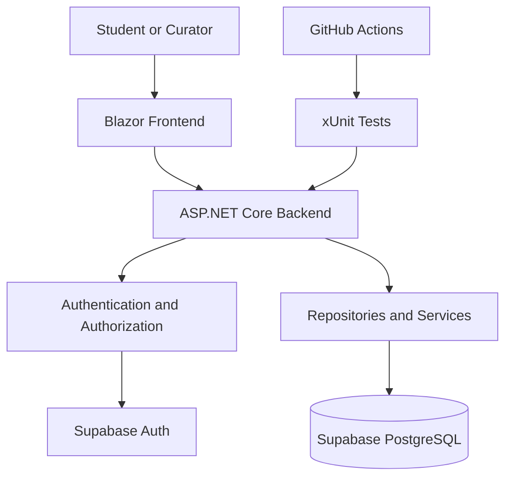

# StudyFlow

StudyFlow is a learning management platform built with
ASP.NET Core Blazor and Supabase.

## Project Overview

The platform helps students manage assignments, track
academic progress, and record UNT mock exam results.

Curators can monitor assigned students and review
their learning progress.

## Main Features

### Student
- Account registration and login
- Personal dashboard
- Assignment management
- Task completion tracking
- UNT mock exam results
- Subject performance analytics

### Curator
- Role-based access
- Assigned student monitoring
- Student assignment overview
- Mock exam performance
- Progress statistics

## Technologies

- C# and .NET 10
- ASP.NET Core Blazor
- Supabase
- PostgreSQL
- xUnit
- GitHub Actions

## Project Structure

- StudyFlow/Components - User interface
- StudyFlow/Services - Business logic and APIs
- StudyFlow/Database - Database migrations
- StudyFlow.Tests - Automated tests
- .github/workflows - Continuous integration

## Running the Project

Requirements:
- .NET 10 SDK
- Configured Supabase project
- Local development credentials

Apply the database migrations in order:
1. 001_schema_supabase.sql
2. 002_roles_and_curator_access.sql

Configure credentials locally using .NET User Secrets.
Do not commit database passwords or API secrets.

Run:

    dotnet run --project StudyFlow/StudyFlow.csproj --no-launch-profile --urls http://localhost:5013

## Automated Testing

Run:

    dotnet test StudyFlow.Tests/StudyFlow.Tests.csproj

Tests cover UNT score calculations and selected
API authorization scenarios.

GitHub Actions runs automated tests on pushes
and pull requests.

## Security

StudyFlow uses authentication and role-based authorization.
Curators are restricted to their assigned students.
Additional security testing is required before production use.

## Team Contributions

- Frontend: Blazor UI, dashboards, and user experience
- Backend: Supabase, PostgreSQL, APIs, and authentication
- Integration and testing: Shared team work

## System Architecture

## Role-Based Access

- Students manage their own tasks and exam results.
- Curators monitor only their assigned students.
- Unauthorized requests to curator APIs return HTTP 403.
- The application uses protected routes and authenticated sessions.
